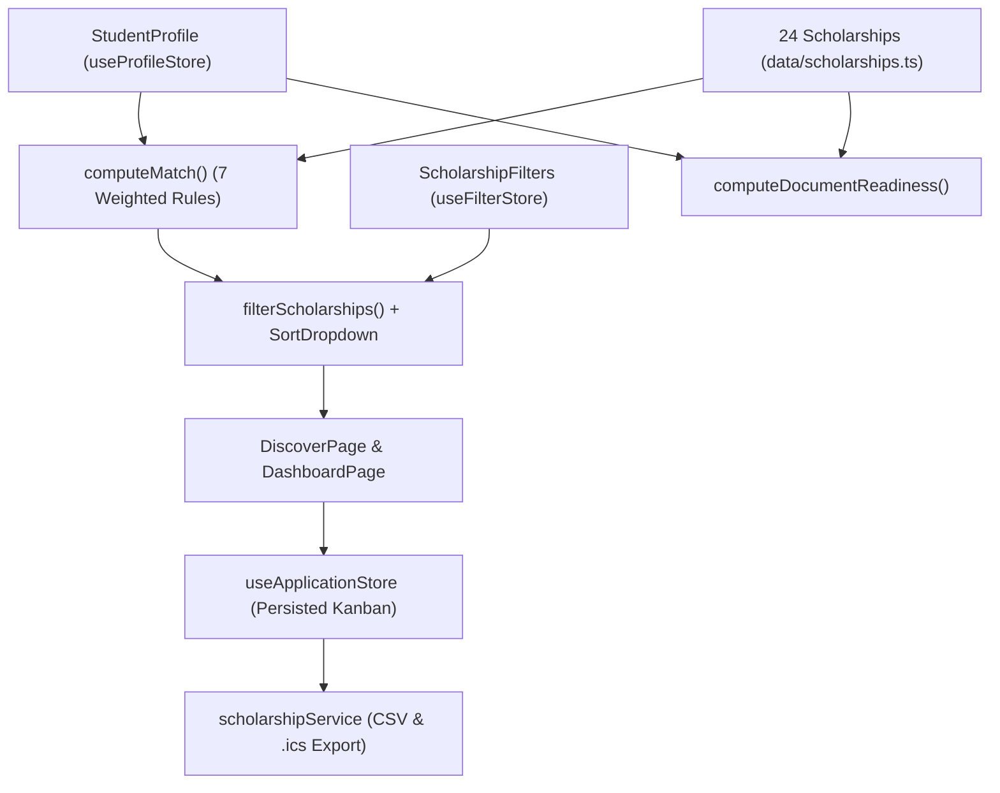

# GRANTLY — Unified Scholarship Discovery & Management Platform

> **Rethinking the Scholarship Experience:** Transform a complex maze of portals, PDFs, and spreadsheets into one seamless, accessible digital journey — **Discover → Match → Understand → Apply → Track → Win**.

---

## Problem Statement Alignment

Accessing educational financial assistance is often a fragmented, stressful journey for students. **Grantly** solves every core pain point in one privacy-first, client-side workspace:

| Student Challenge | How Grantly Solves It |
|---|---|
| **Finding relevant opportunities** | **Discover Page (`/discover`)** — Full-text debounced search (`useDebounce` + `useDeferredValue`), multi-facet filters (education level, field of study, scholarship type, continuous minimum award slider with quick presets, deadline window, and custom frosted-glass *"Only show scholarships I qualify for"* toggle), and custom glassmorphism sorting (`SortDropdown`). |
| **Understanding available options** | **Explainable Eligibility Match Engine (`matchEngine.ts`)** — Every scholarship receives a **0–100% match score** with a criterion-by-criterion explanation (`level`, `percentage`, `income`, `field`, `state`, `gender`, `category`). Plus **Side-by-Side Comparison (`/compare`)** for up to 3 scholarships with responsive mobile cards and desktop comparison tables. |
| **Navigating application processes** | **Interactive Application Workspace (`/scholarships/:id`)** — Step-by-step application checklist with auto-advancing status and a **Document Readiness Meter** synced with the student's Document Vault. |
| **Keeping track of important information** | **3-Column Bento Kanban Tracker (`/tracker`)** with drag-and-drop, accessible custom status menus, full-width single-stage focus views, one-click **CSV Export**, **Urgency Deadline Timeline (`/deadlines`)**, **RFC 5545 `.ics` Calendar Export**, and **Dashboard (`/dashboard`)** with a live Funding Potential calculator. |

---

## Key Features & Innovations

1. **Explainable Eligibility Match Score (`src/features/eligibility/matchEngine.ts`)**
   - Evaluates 7 weighted criteria (`level`, `percentage`, `income`, `field`, `state`, `gender`, `category`).
   - Returns a `0–100` score, a verdict (`eligible`, `likely`, `ineligible`), and human-readable explanations for every check.
2. **Document Readiness Vault (`src/features/documents/`)**
   - Students tick off the documents they already have scanned once in their Profile (`/profile`).
   - Every scholarship immediately calculates readiness (`0–100%`) and highlights missing documents.
3. **Bento Kanban Application Pipeline & CSV Export (`src/features/applications/KanbanBoard.tsx`, `src/services/scholarshipService.ts`)**
   - Full-width 3-column Bento grid for all 6 stages (`Saved`, `Preparing`, `Submitted`, `Interview`, `Awarded`, `Not selected`) plus dedicated single-stage workspace views.
   - Supports HTML5 drag-and-drop, accessible custom listbox status controls, automatic `Saved → Preparing` progression when ticking checklist steps, and RFC 4180 `.csv` spreadsheet export.
4. **Deadline Urgency Radar & iCalendar (`.ics`) Export (`src/features/deadlines/`)**
   - Colour-coded urgency badges (`≤3 days` critical, `≤10 days` soon, `≤30 days` upcoming).
   - Smooth gliding scope toggle (`All open` vs `My tracked`) and one-click RFC 5545 `.ics` file download with 7-day and 1-day `VALARM` reminders.
5. **Optical Fluted-Glass WebGL Shader & Adaptive Dual-Mode Design System (`src/components/layout/ShaderBackground.tsx`)**
   - Custom GLSL fragment shader simulating cylindrical fluted glass reeds with Snell's law normal refraction, RGB chromatic dispersion, Fresnel internal edge reflection, and `0.75` specular glossiness across Light Mode (Sapphire-Periwinkle-Champagne) and Night Mode (Abyssal-Emerald-Jade).
   - Automatically pauses rendering when offscreen and respects `prefers-reduced-motion: reduce`.

---

## System Architecture & Data Flow



---

## Tech Stack

- **Framework:** React 18.3 + TypeScript 5.6 (`strict: true`)
- **Build & Bundling:** Vite 5 (`React.lazy` route-level code splitting + idle route prefetching + manual vendor chunk splitting)
- **WebGL & Styling:** Custom GLSL Refractive Fluted-Glass Fragment Shader + Tailwind CSS 3.4 + CSS Custom Properties (Light & Night themes)
- **Routing & Resilience:** React Router v6 with directional slide transitions, `ErrorBoundary`, and `RouteErrorFallback`
- **State & Persistence:** Zustand 5 with `persist` middleware (`localStorage`)
- **Testing & Quality:** Vitest, React Testing Library (`@testing-library/react`), ESLint 9 (`eslint-plugin-jsx-a11y`), Prettier

---

## Getting Started

### Prerequisites
- Node.js `>= 18.0.0` and `npm >= 9.0.0`

### Installation & Local Development

```bash
# 1. Clone the repository
git clone https://github.com/anshuvdebnath-cyber/OUTPOST-HACKATHON.git
cd OUTPOST-HACKATHON

# 2. Install dependencies
npm install

# 3. Start the Vite development server (http://localhost:5173)
npm run dev
```

### Quality, Testing & Production Build Scripts

```bash
npm run lint          # Run ESLint + jsx-a11y accessibility audit
npm run typecheck     # Run TypeScript strict compiler verification
npm run test          # Run Vitest unit & component test suite
npm run build         # Type-check and build production bundle in dist/
npm run preview       # Preview production build locally
```

---

## Project Directory Structure

```text
src/
├── app/
│   └── router.tsx                  # React.lazy code-split routes, Suspense skeletons & idle preloader
├── components/
│   ├── layout/                     # AppShell, Adaptive Logo, ShaderBackground, SkipLink, ThemeToggle
│   └── ui/                         # Button, EmptyState, ErrorBoundary, PageHeader, ProgressBar, Skeleton, SortDropdown, Toaster
├── data/
│   └── scholarships.ts             # 24 curated Indian scholarships with relative ISO deadlines
├── features/
│   ├── applications/               # 3-column Bento KanbanBoard, SingleStagePanel & status popover
│   ├── deadlines/                  # CountdownBadge, generateIcs (RFC 5545 .ics calendar generator)
│   ├── documents/                  # DocumentReadinessMeter & pure documentReadiness scorer
│   ├── eligibility/                # matchEngine (7-rule weighted scorer), MatchBadge, MatchReasons
│   └── scholarships/               # ScholarshipCard, FilterPanel, filterScholarships engine
├── hooks/                          # useDebounce, useDocumentTitle, useMatch, useMediaQuery
├── lib/                            # cn, constants, currency (INR), date, performance (Core Web Vitals)
├── pages/                          # Landing, Dashboard, Discover, Detail, Tracker, Deadlines, Compare, Profile, NotFound
├── services/                       # scholarshipService (portfolio analytics & RFC 4180 CSV exporter)
├── store/                          # Persisted Zustand stores (profile, applications, compare, filters, theme, toast)
├── styles/                         # Tailwind layers, glassmorphism tokens, multi-breakpoint responsive rules
└── types/                          # Strict TypeScript domain interfaces
```

See [`docs/ARCHITECTURE.md`](./docs/ARCHITECTURE.md) and [`docs/ACCESSIBILITY.md`](./docs/ACCESSIBILITY.md) for in-depth engineering documentation.

---

## License

Released under the [MIT License](./LICENSE).
