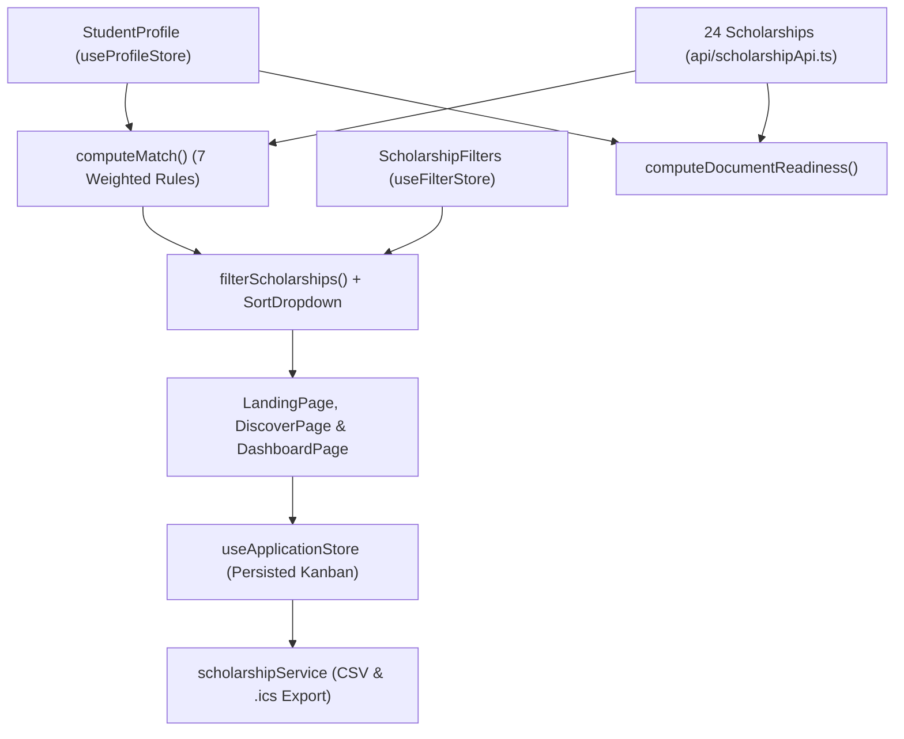

# GRANTLY — Unified Scholarship Discovery & Management Platform

[](https://www.typescriptlang.org/)
[](https://react.dev/)
[](https://vitejs.dev/)
[](https://tailwindcss.com/)
[](./LICENSE)

> **Rethinking the Scholarship Experience:** Transform a complex maze of portals, PDFs, and spreadsheets into one seamless, accessible digital journey — **Discover → Match → Understand → Apply → Track → Win**.

---

## Overview

Accessing educational financial assistance is often a fragmented, stressful journey for students. **Grantly** unifies scholarship discovery, explainable eligibility matching, document readiness tracking, multi-year tuition coverage simulation, and Kanban application management in one privacy-first workspace:

| Student Challenge | How Grantly Solves It |
|---|---|
| **Finding relevant opportunities** | **Discover Workspace (`/` & `/discover`)** — Full-text debounced search (`useDebounce` + `useDeferredValue`), multi-facet filters (education level, field of study, scholarship type, continuous minimum award slider with quick presets, deadline window, and custom frosted-glass *"Only show scholarships I qualify for"* toggle), and custom glassmorphism sorting (`SortDropdown`). |
| **Understanding available options** | **Explainable Eligibility Match Engine (`matchEngine.ts`)** — Every scholarship receives a **0–100% match score** with a criterion-by-criterion explanation (`level`, `percentage`, `income`, `field`, `state`, `gender`, `category`). Plus **Side-by-Side Comparison (`/compare`)** for up to 3 scholarships. |
| **Navigating application processes** | **Interactive Application Workspace (`/scholarships/:id`)** — Step-by-step application checklist with auto-advancing status, personal portal ID notes, and a **Document Readiness Meter** synced with the student's Document Vault. |
| **Keeping track of important information** | **3-Column Bento Kanban Tracker (`/tracker`)** with drag-and-drop, accessible custom status menus, single-stage focus views, one-click **CSV Export**, **Urgency Deadline Timeline (`/deadlines`)**, **RFC 5545 `.ics` Calendar Export**, and **Dashboard (`/dashboard`)** with a **Multi-Year Tuition & Scholarship Coverage Estimator**. |

---

## Features

1. **Explainable Eligibility Match Score (`src/features/eligibility/matchEngine.ts`)**
   - Evaluates 7 weighted criteria (`level`, `percentage`, `income`, `field`, `state`, `gender`, `category`).
   - Returns a `0–100` score, a verdict (`eligible`, `likely`, `ineligible`), and human-readable explanations for every check.
2. **Document Readiness Vault (`src/features/documents/`)**
   - Students tick off the documents they already have scanned once in their Profile (`/profile`).
   - Every scholarship immediately calculates readiness (`0–100%`) and highlights missing documents.
3. **Bento Kanban Application Pipeline & CSV Export (`src/features/applications/KanbanBoard.tsx`, `src/services/scholarshipService.ts`)**
   - Full-width 3-column Bento grid for all 6 stages (`Saved`, `Preparing`, `Submitted`, `Interview`, `Awarded`, `Not selected`) plus dedicated single-stage workspace views and inline note taking.
   - Supports HTML5 drag-and-drop, accessible custom listbox status controls, automatic `Saved → Preparing` progression when ticking checklist steps, and RFC 4180 `.csv` spreadsheet export.
4. **Deadline Urgency Radar & iCalendar (`.ics`) Export (`src/features/deadlines/`)**
   - Colour-coded urgency badges (`≤3 days` critical, `≤10 days` soon, `≤30 days` upcoming) and one-click RFC 5545 `.ics` download with 7-day and 1-day `VALARM` reminders.
5. **Multi-Year Tuition & Financial Aid Coverage Estimator (`src/pages/DashboardPage.tsx`)**
   - Interactive financial calculator that models annual tuition/hostel costs across 1–6 study years against the student's tracked and eligible scholarship pool.
6. **Optical Fluted-Glass WebGL Shader & Adaptive Dual-Mode Design System (`src/components/layout/ShaderBackground.tsx`)**
   - Custom GLSL fragment shader simulating cylindrical fluted glass reeds with Snell's law normal refraction, RGB chromatic dispersion, Fresnel internal edge reflection, and `0.75` specular glossiness across Light Mode and Night Mode.

---

## Tech Stack

- **Framework:** React 18.3 + TypeScript 5.6 (`strict: true`)
- **Build & Bundling:** Vite 5 (`React.lazy` code splitting, idle route prefetching, vendor chunk splitting, PWA Service Worker)
- **WebGL & Styling:** Custom GLSL Refractive Fluted-Glass Fragment Shader + Tailwind CSS 3.4 + CSS Custom Properties & `@container` queries
- **Routing & Resilience:** React Router v6 with directional slide transitions, `ErrorBoundary`, and `RouteErrorFallback`
- **State & Persistence:** Zustand 5 with `persist` middleware (`localStorage`) + React Context (`ScholarshipContext`)
- **Testing & Quality:** Vitest, React Testing Library (`@testing-library/react`), ESLint 9 (`eslint-plugin-jsx-a11y`), Prettier

---

## Architecture



### Project Structure

```text
src/
├── api/                            # Typed async scholarship API client with TTL cache & AbortController
├── app/                            # Route definitions, React.lazy chunks & idle preloader
├── components/
│   ├── layout/                     # AppShell, Adaptive Logo, ShaderBackground, SkipLink, ThemeToggle
│   └── ui/                         # Button, EmptyState, ErrorBoundary, PageHeader, ProgressBar, Skeleton, SortDropdown, Toaster
├── config/                         # Centralized environment & runtime configuration (appConfig.ts)
├── constants/                      # Domain constants barrel
├── context/                        # ScholarshipContext provider & hook
├── data/                           # 24 curated Indian scholarships with relative ISO deadlines
├── features/
│   ├── applications/               # 3-column Bento KanbanBoard, SingleStagePanel & status popover
│   ├── deadlines/                  # CountdownBadge, generateIcs (RFC 5545 .ics calendar generator)
│   ├── documents/                  # DocumentReadinessMeter & pure documentReadiness scorer
│   ├── eligibility/                # matchEngine (7-rule weighted scorer), MatchBadge, MatchReasons
│   └── scholarships/               # ScholarshipCard, FilterPanel, filterScholarships engine
├── hooks/                          # useDebounce, useDocumentTitle, useMatch, useMediaQuery
├── lib/                            # cn, constants, currency (INR), date, performance (Core Web Vitals)
├── pages/                          # Landing, Dashboard, Discover, Detail, Tracker, Deadlines, Compare, Profile, NotFound
├── services/                       # scholarshipService (portfolio analytics & RFC 4180 CSV exporter)
├── store/                          # Persisted Zustand stores (profile, applications, compare, filters, theme, toast)
├── styles/                         # Tailwind layers, glassmorphism tokens, @container & multi-breakpoint rules
├── types/                          # Strict TypeScript domain interfaces
└── utils/                          # Input sanitization, URL validation & security helpers
```

---

## Getting Started

### Prerequisites

- **Node.js** `>= 18.0.0`
- **npm** `>= 9.0.0`

### Installation

```bash
# 1. Clone the repository
git clone https://github.com/anshuvdebnath-cyber/OUTPOST-HACKATHON.git
cd OUTPOST-HACKATHON

# 2. Install dependencies
npm install

# 3. Copy environment template (optional)
cp .env.example .env.local

# 4. Start the development server at http://localhost:5173
npm run dev
```

---

## Environment Variables

See [`.env.example`](./.env.example) for all supported Vite configuration keys:

| Variable | Default | Description |
|---|---|---|
| `VITE_APP_NAME` | `Grantly` | Application display name |
| `VITE_APP_TAGLINE` | `Unified Scholarship Discovery & Management Platform` | Platform subtitle |
| `VITE_DEFAULT_CURRENCY` | `INR` | Default currency formatting code |
| `VITE_STORAGE_PREFIX` | `grantly` | LocalStorage namespace prefix |
| `VITE_ENABLE_PERF_MONITORING` | `true` | Enables Core Web Vitals telemetry |

---

## Usage

1. **Interactive Discovery & Live Eligibility (`/` & `/discover`):** Search by keyword, filter by education level, scholarship category, field of study, minimum award slider, or toggle *"Only show scholarships I qualify for"*.
2. **Global Quick Finder (`Ctrl+K` / `Cmd+K`):** Press `Ctrl+K` from any screen to search scholarships, inspect match scores, and export `.ics` deadlines immediately.
3. **Profile & Document Vault (`/profile`):** Load one of the 3 sample student personas (*Ananya — B.Tech CSE*, *Rohan — Class 12*, *Meera — M.Sc Biotech*) or enter your own marks, income, and owned documents.
4. **Kanban Application Tracker (`/tracker`):** Drag cards across 6 stages, tick off application steps, record portal IDs/notes, or export your pipeline to `.csv`.
5. **Urgency Radar & Comparison (`/deadlines` & `/compare`):** Export upcoming deadlines to Google/Apple/Outlook Calendar (`.ics`) and compare up to 3 scholarships side by side.

---

## API Reference

The client-side service and API modules expose deterministic, typed functions:

- `fetchScholarshipCatalog(filters?, options?)` (`src/api/scholarshipApi.ts`): Returns `Promise<ApiResponse<Scholarship[]>>` with `AbortSignal` and in-memory TTL caching.
- `fetchScholarshipById(id, options?)` (`src/api/scholarshipApi.ts`): Resolves a single scholarship record by ID.
- `computeMatch(profile, scholarship)` (`src/features/eligibility/matchEngine.ts`): Evaluates 7 weighted eligibility rules and returns `{ score, verdict, checks }`.
- `computePortfolioAnalytics(scholarships, applications, profile)` (`src/services/scholarshipService.ts`): Computes aggregate funding pool, average match score, and stage breakdown.
- `downloadApplicationsCsv(applications)` (`src/services/scholarshipService.ts`): Generates and downloads an RFC 4180 `.csv` spreadsheet.
- `downloadIcs(scholarships, filename)` (`src/features/deadlines/generateIcs.ts`): Generates and downloads an RFC 5545 `.ics` calendar file.

---

## Testing

Run the automated test, typecheck, and accessibility lint suites:

```bash
npm run typecheck     # TypeScript strict compiler verification (0 errors)
npm run lint          # ESLint + jsx-a11y accessibility audit (0 warnings)
npm test              # Vitest unit & component test suite (37+ tests)
```

---

## Deployment

Build the production-ready static bundle into `dist/`:

```bash
npm run build
npm run preview
```

The generated `dist/` folder can be deployed directly to Vercel, Netlify, Cloudflare Pages, or GitHub Pages with SPA fallback routing to `/index.html`.

---

## Contributing

Contributions are welcome! Please read [`CONTRIBUTING.md`](./CONTRIBUTING.md) and [`CHANGELOG.md`](./CHANGELOG.md) for guidelines and release history, and see [`docs/ARCHITECTURE.md`](./docs/ARCHITECTURE.md) and [`docs/ACCESSIBILITY.md`](./docs/ACCESSIBILITY.md) for architectural details.

---

## License

Released under the [MIT License](./LICENSE).
